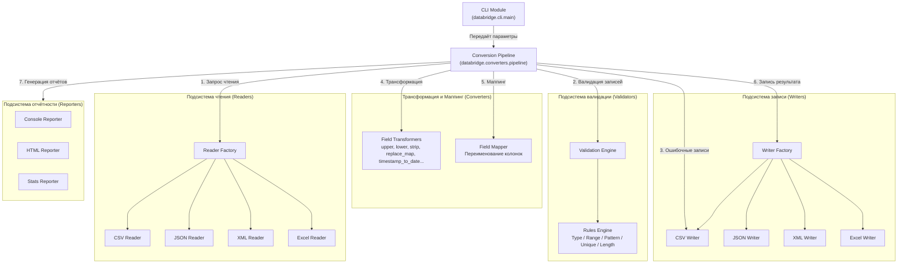
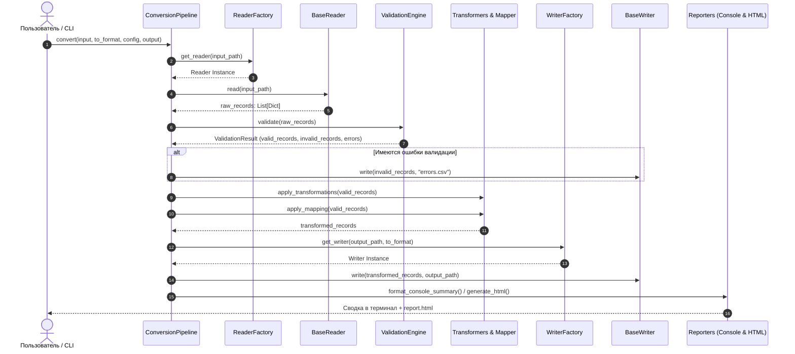

# Архитектура системы DataBridge (Architecture)

**Проект:** DataBridge — Конвертер и валидатор данных  
**Архитектурный шаблон:** Модульный конвейер обработки данных (Pipeline Architecture) с применением порождающих и поведенческих шаблонов проектирования (Factory Method, Strategy, Template Method).

---

## 1. Концептуальная схема и диаграмма компонентов

DataBridge построен по принципу слабой связанности (Low Coupling) и высокой связности (High Cohesion). Вся логика разделена на 5 независимых модулей:

---

## 2. Диаграмма последовательности обработки данных (Sequence Diagram)

---

## 3. Описание модулей

### 3.1. `databridge.readers`
- **`BaseReader`** — абстрактный базовый класс, декларирующий метод `read(file_path: str, **kwargs) -> List[Dict[str, Any]]`.
- **`CSVReader`** — чтение CSV/TSV с автоопределением разделителя или явной настройкой, сохранением порядка строк, поддержкой файлов без заголовков.
- **`JSONReader`** — чтение JSON-массивов или объектов-обёрток с безопасной проверкой типов структуры.
- **`XMLReader`** — чтение плоских XML деревьев (теги записей и их дочерние элементы/атрибуты).
- **`ExcelReader`** — чтение файлов `.xlsx` с использованием движка `openpyxl`.
- **`factory.py`** — фабричный метод `get_reader(file_path, format_override)` на основе расширения или флага.

### 3.2. `databridge.validators`
- **`ValidationConfig` / `FieldRule` / `ValidationError`** — строгие модели данных на базе `@dataclass`.
- **`rules.py`** — чистые функции валидации типов (`validate_type`), диапазонов (`validate_range`), шаблонов regex (`validate_pattern`), длин строк (`validate_length`).
- **`ValidationEngine`** — управляющий движок:
  - Загружает правила из YAML / JSON;
  - Отслеживает глобальный контекст уникальности (`unique: true`) через множества (`Set`);
  - Формирует объект `ValidationResult` со сводной статистикой и детализацией.

### 3.3. `databridge.converters`
- **`transformers.py`** — библиотека функций очистки и модификации данных:
  - `upper`, `lower`, `strip`, `capitalize`;
  - `replace_map` (подстановка по словарю с поддержкой значения по умолчанию);
  - `timestamp_to_date` (Unix timestamp → ISO дата);
  - `format_date` (конвертация формата дат);
  - `default` (заполнение пустых полей).
- **`mapper.py`** — класс `FieldMapper` для переименования колонок по правилам конфигурации.
- **`pipeline.py`** — центральный оркестратор `ConversionPipeline`.

### 3.4. `databridge.writers`
- **`BaseWriter`** — абстрактный базовый класс с методом `write(records, file_path, **kwargs)`.
- Реализации: `CSVWriter`, `JSONWriter`, `XMLWriter`, `ExcelWriter`.
- Автоматически создает целевые директории при необходимости и очищает записи от внутренних метаполей (`_row_number`, `_errors`).

### 3.5. `databridge.reporters`
- **`console.py`** — форматирование краткой сводки выполнения в точном соответствии с образцом ТЗ.
- **`html_reporter.py`** — генерация визуального автономного HTML-отчета со стилизацией, сводными карточками метрик, таблицами распределения ошибок и журналом.
- **`stats_reporter.py`** — профилировщик структуры данных для команды `databridge stats`.

---

## 4. Стратегия расширяемости (Extensibility)

Архитектура строго следует принципу **Open/Closed (SOLID)**:
1. **Добавление нового формата (например, Parquet, YAML, TOML):**
   - Создать класс в `readers/` унаследовав от `BaseReader`.
   - Создать класс в `writers/` унаследовав от `BaseWriter`.
   - Зарегистрировать формат в `EXTENSION_MAP` соответствующих фабрик.
   - Движок валидации, CLI и трансформеры не требуют изменений.
2. **Добавление новой трансформации:**
   - Написать функцию `def transform_custom(val, **kwargs)` в `transformers.py`.
   - Зарегистрировать в словаре `TRANSFORMERS`.
   - Трансформация сразу становится доступной в YAML/JSON конфигах.
3. **Добавление нового правила валидации:**
   - Добавить проверку в `rules.py` и вызвать в цикле `ValidationEngine.validate`.
